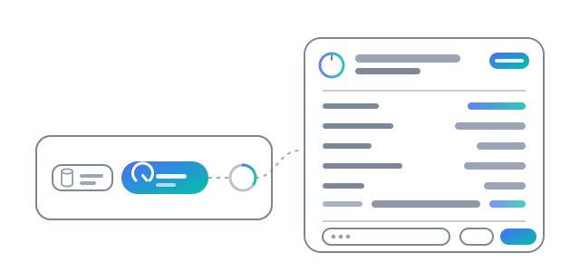

# dsh-minimax-token-plan

Show the remaining **MiniMax Token Plan (M Plan)** quota right inside the
DeepSeek Harness composer — between the `token 用量` pill and the `上下文已用`
ring.

[中文说明](#中文说明)


[](https://dshopen.org/zh/plugins/dsh-minimax-token-plan/)



## What it does

- A slim quota pill in the session footer. It shows the **5-hour remaining**
  percentage by default.
- Click the pill to open a panel with the **5-hour** and **weekly** remaining
  quota, the reset countdown, a per-model breakdown and the settings.
- The default metric is configurable: `5-hour remaining`, `weekly remaining`,
  **lowest absolute tokens** or **lowest percentage**.
- The API key is **encrypted at rest**: it is sealed with AES-256-GCM using a
  non-extractable key that only ever lives in the local IndexedDB. The key
  never touches the plugin configuration, the profile file, or a log line.
- Requests only ever reach the official MiniMax hosts
  (`api.minimax.io` / `api.minimax.cn`).

## Install

### From the open plugin market

Add the [open plugin market](https://dshopen.org) index in
*Settings → Plugins → Discover*, search for **MiniMax Token Plan** and install.

### From GitHub

Add the bundle to your profile's `package.json` and patch it in:

```jsonc
// cordis.patch.yml
- insert:
    - id: minimax-token-plan
      name: 'dsh-minimax-token-plan'
```

```jsonc
// package.json
{
  "dependencies": {
    "dsh-minimax-token-plan": "github:Aujin/dsh-minimax-token-plan#<commit>"
  },
  "dsh": {
    "profile": {
      "bundles": ["dsh-minimax-token-plan"]
    }
  }
}
```

Restart DSH afterwards.

## Configure

Open the pill → **设置 / Settings**:

| Setting | Meaning |
| --- | --- |
| **API Key** | Your MiniMax M Plan key (`sk-cp-…`). Stored encrypted, never uploaded anywhere but MiniMax. |
| **服务区域 / Service region** | `自动检测` (probe both regions), `国际 api.minimax.io`, or `中国 api.minimax.cn`. |
| **默认显示 / Default metric** | `5 小时剩余`, `周剩余`, `绝对 token 最低`, `百分比最低`. |
| **刷新间隔 / Refresh interval** | How often the quota is re-read, in minutes (1–60, default 5). |

> The plan decides which numbers it can report: text plans usually expose
> **percentages only** for the five-hour and weekly windows, while image/video
> plans expose absolute counts. When the plan reports no absolute counts the
> "absolute lowest" metric shows `—` and the panel says so.

> **Why the weekly number can exceed 100 %:** MiniMax grants some plans a
> multiplier on the weekly window (`weekly_boost_permille`, e.g. `1500` = 1.5×).
> The remaining share is then reported against the boosted allowance, so
> `76 % × 1.5 = 114 %`. The plugin keeps that number — like the official
> `mmx quota` command does — and names the multiplier next to it
> (`含 1.5× 加成（基础 76%）` / `1.5× boost included (base 76%)`), so it never
> looks like a broken percentage.

## How it works

- The quota comes from the official endpoint
  `GET {base}/v1/token_plan/remains` with `Authorization: Bearer <M Plan key>`.
- The `*_usage_count` fields changed meaning between MiniMax server versions
  (remaining vs. consumed). The plugin disambiguates them with the server
  percentage, exactly like the official `mmx quota` command does.
- The weekly percentage is boosted with `weekly_boost_permille` when the plan
  reports one, so a boosted plan can show more than 100% — the panel names the
  multiplier next to the reading.

## Privacy

- The API key is stored **encrypted** (AES-256-GCM, non-extractable key) in the
  browser's IndexedDB for the DSH origin. It is never written into the DSH
  profile, the plugin configuration, or the session log.
- Only `api.minimax.io` and `api.minimax.cn` are contacted.
- No analytics, no third-party services.

## License

[MIT](LICENSE)

## 中文说明

在 DeepSeek Harness 会话底部的 `token 用量` 右侧、`上下文已用` 左侧，显示
**MiniMax Token Plan（M Plan）** 的剩余用量。

- 默认显示 **5 小时剩余**百分比；点击展开面板，可同时查看 **5 小时** 与
  **每周**剩余、重置倒计时、分模型明细以及设置。
- 默认显示的指标可配置：`5 小时剩余`、`周剩余`、`绝对 token 最低`、
  `百分比最低`。
- API Key **加密保存**：使用不可导出的 AES-256-GCM 密钥加密后存入浏览器
  IndexedDB，不会写入 DSH 配置、profile 文件或日志。
- 只会请求 MiniMax 官方域名（`api.minimax.io` / `api.minimax.cn`）。

安装：在 *设置 → 插件 → 开放插件市场* 搜索 **MiniMax Token Plan**；或按上面的
[GitHub 安装](#install) 方式把本仓库加入 profile。

> 套餐决定能显示哪些数字：文本套餐通常只提供百分比，图像/视频套餐才提供绝对
> 次数；当套餐不提供绝对次数时，“绝对 token 最低”显示 `—`。

> **为什么周剩余会超过 100%：** MiniMax 会给部分套餐的周窗口一个倍率
> （`weekly_boost_permille`，如 `1500` 表示 1.5×）。剩余比例是按加成后的额度
> 计算的，于是 `76% × 1.5 = 114%`。插件保留这个数字（与官方 `mmx quota` 一致），
> 并在旁边标注倍率（`含 1.5× 加成（基础 76%）`），避免看起来像百分比出错。

许可证：[MIT](LICENSE)
